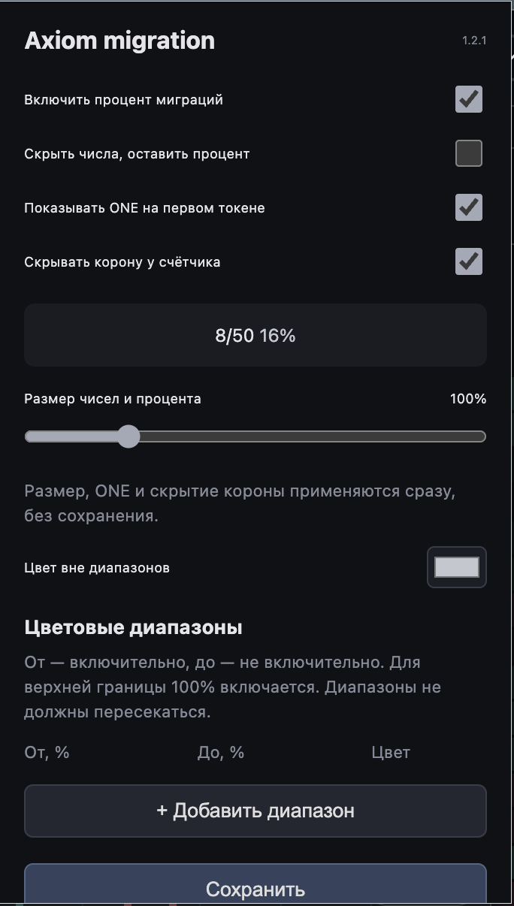

# Axiom migration

**Версия 1.2.1 · Chrome · Axiom Pulse**

Показывает процент миграций дева рядом с нативным счётчиком Axiom и выделяет его по вашим цветовым диапазонам. Дополнительно умеет показывать ONE на первом токене и скрывать корону счётчика.

## Настройки

- Включение процента миграций.
- Скрытие исходных чисел: оставить только процент.
- Метка **ONE** внутри Quick Buy, когда общее число токенов дева равно ровно 1.
- Независимое скрытие короны у счётчика.
- Размер чисел и процента: 60–250%.
- Цвет вне диапазонов и произвольные непересекающиеся цветовые диапазоны.

Размер, ONE и скрытие короны применяются сразу. Изменения диапазонов и остальных настроек процента применяются кнопкой **Сохранить**.

## Установка

1. Скачайте ZIP репозитория через **Code → Download ZIP** и распакуйте его.
2. Откройте `chrome://extensions` и включите **Режим разработчика**.
3. Нажмите **Загрузить распакованное расширение** и выберите папку с `manifest.json`.
4. Обновите вкладку Axiom. Настройки открываются нажатием на значок расширения в Chrome.

Сборка и установка npm-зависимостей не требуются. После обновления файлов перезагрузите расширение на странице `chrome://extensions` и обновите Axiom.
